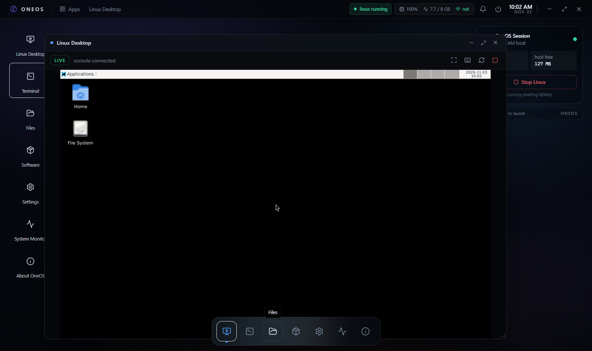

# OneOS

OneOS is a Windows 11 desktop application that contains a real Linux computer.
It runs a Debian guest under QEMU/WHPX, persists it on a QCOW2 disk, and streams
the guest framebuffer into its own window through a loopback noVNC session. No
external browser, no Electron, no WSL, no container: a full virtual machine with
firmware, disk, network and console, wrapped in a desktop shell.



The guest is not an emulated shell: it boots Debian 13 with XFCE, runs its own
package manager, keeps its files on a persistent disk, and is reachable through
the QEMU guest agent for the terminal, file manager and software installer.

```
OneOS window
┌──────────────────────────────────────────────────────────────┐
│ boot splash → first-run wizard → desktop shell               │
│                                                              │
│  React 19 + TypeScript (UI only)                             │
│        │ Tauri IPC (39 commands, serde)                       │
│  Rust backend (tokio)                                        │
│        ├── QEMU 11.1 process (WHPX / TCG)                     │
│        │     ├── QCOW2 disk   data/virtual-machines/<id>/     │
│        │     ├── OVMF pflash  edk2-x86_64-code.fd + vars      │
│        │     ├── ISO          data/isos/*.iso                 │
│        │     ├── QMP         127.0.0.1:<random>               │
│        │     ├── VNC         127.0.0.1:<random> + password    │
│        │     └── QGA         127.0.0.1:<random>               │
│        ├── WebSocket↔VNC proxy on 127.0.0.1 + session token    │
│        └── SQLite (data/oneos.db) for config, settings, logs  │
│                                                              │
│  WebView2 renders noVNC (RFB over the local proxy)            │
└──────────────────────────────────────────────────────────────┘
```

## Status

Working today:

* Portable QEMU 11.1 runtime inside `resources/qemu` (no PATH, registry or
  system-wide installation).
* QEMU discovery, version probe, WHPX capability probe, OVMF discovery.
* VM configuration, QCOW2 disk creation, ISO discovery.
* VM lifecycle: start, stop (graceful `system_powerdown`, then `quit`, then
  kill), restart, crash detection with the QEMU stderr tail.
* Embedded console: QEMU VNC (password protected) → loopback WebSocket proxy
  with a per-session token → noVNC inside the OneOS window.
* Guest integration through the QEMU guest agent: status, shell commands,
  directory listing, mkdir, rename, delete, text read/write, file import/export.
  Timed-out calls are resynchronised with `guest-sync` and retried once.
* Automated Debian 13 guest: `scripts/setup-cloud-guest.ps1` installs the cloud
  image and a cloud-init seed (NoCloud `CIDATA` ISO) that creates the user,
  installs `qemu-guest-agent`, XFCE, lightdm and the DRM-capable kernel, then
  boots straight to the desktop. The interactive installer remains available.
* Session lock: a self-contained PIN (salted SHA-256 in SQLite, 30 s cool-down
  after five failures), lock on start-up, Ctrl+L.
* Software window with a Linux catalogue (apt through the guest agent) and a
  Windows catalogue that only opens official download pages.
* Host telemetry (CPU, memory, load, uptime), prerequisite report, application
  logs, persistence of settings.
* Desktop shell: taskbar, launcher, window manager, guest display window,
  terminal, file manager, monitor, settings, power menu.

Not implemented / limited (see `docs/known-limitations.md`):

* One VM at a time; no snapshot manager, no clipboard bridge, no audio.
* The guest console needs a kernel with a DRM driver (`bochs-drm`); Debian's
  cloud kernel has none, so the automated seed installs `linux-image-amd64`.
* Hardware acceleration (WHPX) requires the Windows features and one reboot.
  Until then the guest runs on TCG (software emulation) which is slow.

## Requirements

| Item | Requirement |
| --- | --- |
| Windows | Windows 11 (tested on Pro 25H2, build 26200) |
| CPU | x86-64 with VT-x/AMD-V for WHPX; any x86-64 for TCG |
| RAM | 8 GB host minimum, 16 GB recommended |
| Disk | ~2 GB for the runtime + 25 GB dynamic disk + ~325 MB cloud image |
| Windows features | HypervisorPlatform + VirtualMachinePlatform (WHPX) |
| Runtime | WebView2 (present on Windows 11 by default) |
| Build only | Rust 1.85+, Node 20+, MSVC Build Tools, Windows SDK |

## Running

```powershell
# development (Vite + debug binary)
npm run tauri dev

# production build + NSIS installer
npm run tauri build
# → src-tauri/target/release/oneos.exe
# → src-tauri/target/release/bundle/nsis/OneOS_0.1.0_x64-setup.exe
```

The data root is resolved in this order: `ONEOS_HOME`; the folder that contains
`resources/` or `data/` next to the executable (installed layout); the source
checkout that contains `package.json` + `scripts/` (so a dev run never puts a
25 GB disk inside `target/`); the executable's own folder (portable); and finally
`%LOCALAPPDATA%\OneOS`.

## First run

1. The wizard checks QEMU, firmware, free disk and free memory.
2. Choose guest memory/CPU/disk and whether to use WHPX and UEFI.
3. Get a Debian image into `data/isos`.

### Automated install (recommended)

The Debian 13 *genericcloud* image boots already installed, so a cloud-init seed
does the rest:

```powershell
# once: ~325 MiB download
curl.exe -L -o data\isos\debian-13-genericcloud-amd64.qcow2 `
  https://cloud.debian.org/images/cloud/trixie/latest/debian-13-genericcloud-amd64.qcow2

# stop the Linux machine in OneOS, then swap in the cloud image + seed
powershell -File scripts\setup-cloud-guest.ps1 -VmDir "data\virtual-machines\<id>"
```

Start the machine and let the first boot run (25-60 minutes under TCG: it
downloads XFCE and the kernel). The console shows apt output; afterwards the
machine boots into the XFCE desktop with autologin. Guest credentials are
`oneos` / `oneos` — change them inside the guest and delete `seed.iso` (it
contains that initial password). See `docs/installation.md` for details.

### Interactive install

Pick a Debian ISO in the wizard, choose **Install mode**, and complete the
installer inside the console (choose the XFCE task). Then install the agent:

```sh
sudo apt install qemu-guest-agent
sudo systemctl enable --now qemu-guest-agent
```

After installation, turn off **Install mode** in Settings → Machine (the wizard
only enables it for the installation boot) and start the VM normally.

## Documentation

* `docs/architecture.md` – components, flows, ports, data model
* `docs/installation.md` – prerequisites, build, deploy, first run
* `docs/development.md` – repository layout, commands, coding rules
* `docs/security.md` – trust boundaries and controls
* `docs/known-limitations.md` – honest hardware and feature limits
* `docs/recovery.md` – what to do when the guest or QEMU misbehaves
* `docs/roadmap.md` – next steps
* `reports/system-audit.md` – the original host audit
* `reports/test-report.md` – what was actually executed and observed
* `reports/dependency-report.md` – every third-party component and licence

## Licence

Project code: MIT. QEMU is GPL-2.0 (shipped as a separate executable). noVNC is
MPL-2.0. Debian is distributed under its own DFSG licences. See
`docs/security.md` and `reports/dependency-report.md`.
